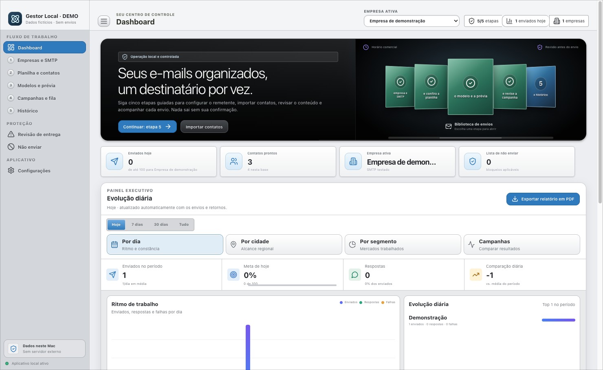
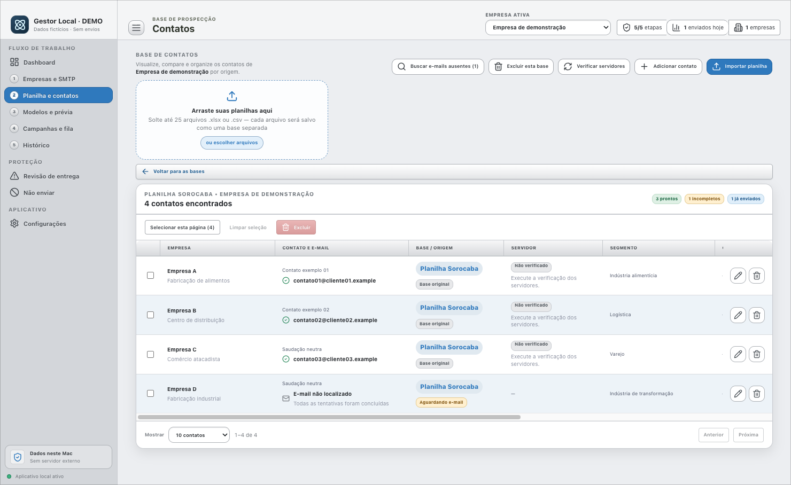
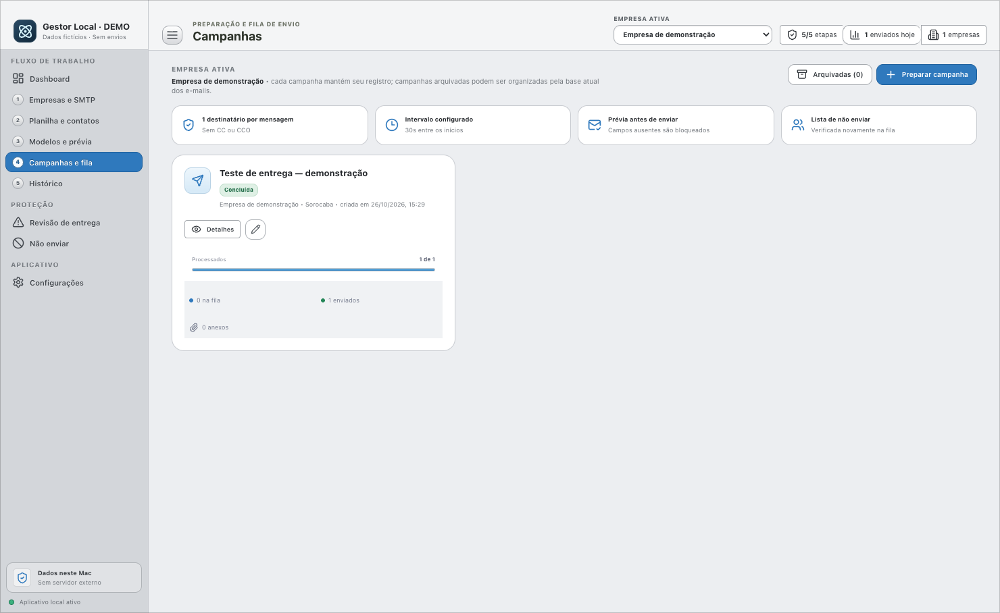
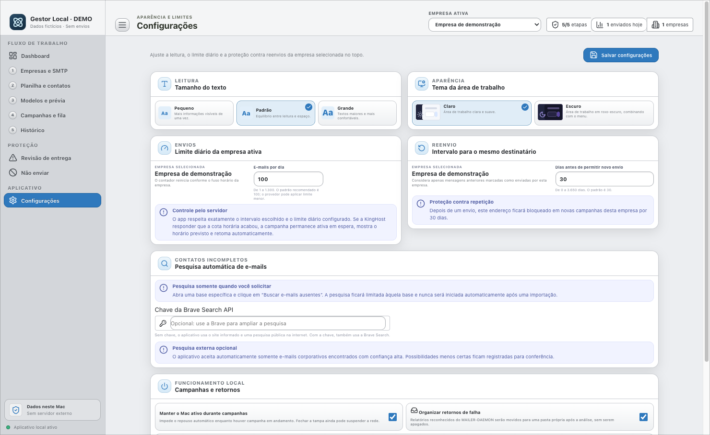
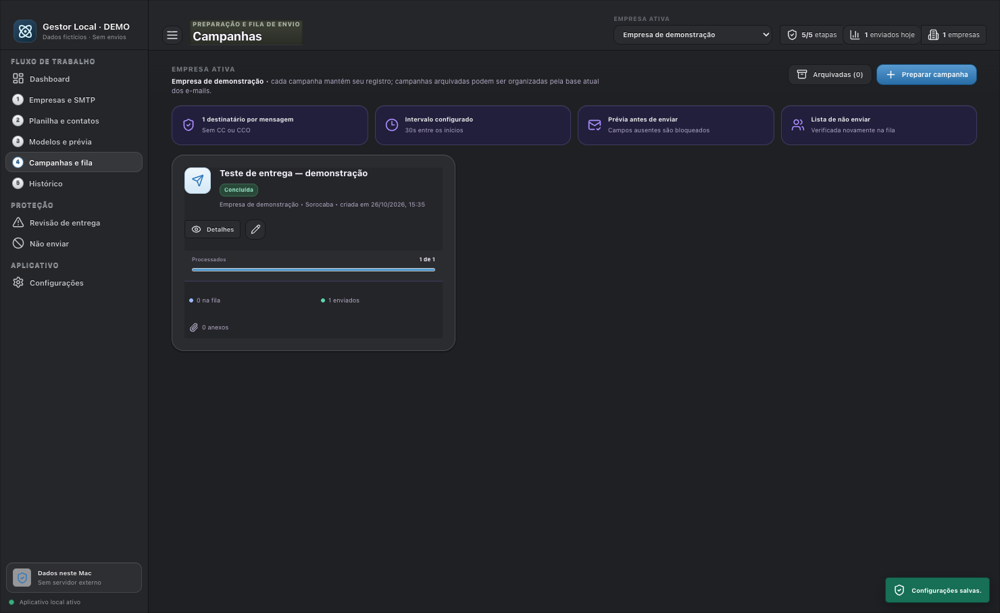
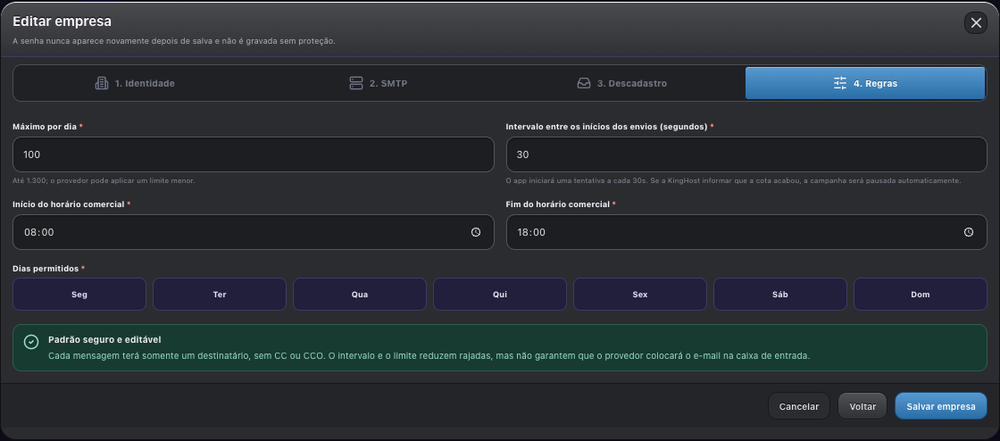
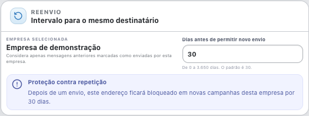
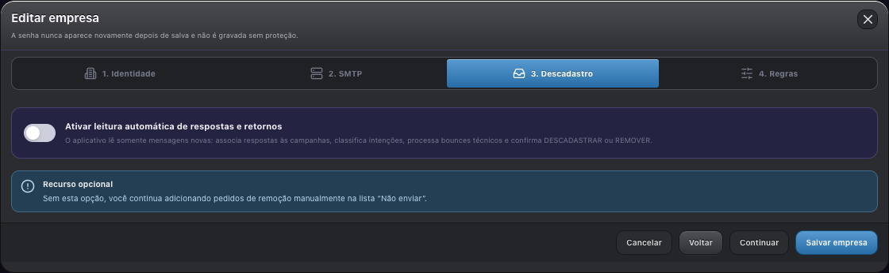

# Gestor de E-mails Local

**Da planilha ao acompanhamento de cada conversa.**

Um aplicativo que desenvolvi para minha rotina de prospecção comercial, usando IA como orientação durante meu aprendizado.

[Como funciona](#como-funciona-na-prática) · [Telas](#um-pouco-da-interface) · [Controles de envio](#dias-horários-e-ritmo-de-envio) · [IA no desenvolvimento](#um-projeto-híbrido-desde-o-começo)

macOS · Intel e Apple Silicon · Dados locais · Código privado

## Um projeto híbrido, desde o começo

Quando comecei a desenvolver este aplicativo, eu ainda estava aprendendo a usar IA. No desenvolvimento original, ela entrou como um guia: um apoio para tirar dúvidas, entender caminhos e pensar nas soluções enquanto eu construía o que precisava para o meu trabalho.

É nesse sentido que chamo o projeto de híbrido. Eu definia o problema, tomava as decisões e testava na prática; a IA me ajudava a aprender durante o processo.

O visual não está bonito — está longe do que eu gostaria. Naquele momento, minha prioridade era fazer funcionar e resolver minha necessidade. Preferi mostrar a interface como ela é, com o que funciona e o que ainda quero melhorar.

As capturas mostram o aplicativo aberto, com dados fictícios para preservar a privacidade. A versão de apresentação e a adaptação recente para Apple Silicon foram preparadas com assistência de IA.

---

*Uma visão da rotina reunida em uma tela: contatos, campanhas e acompanhamento. Foi essa organização que procurei construir com apoio de IA.*

> O aplicativo já é usado por mim. Para mostrar como ele funciona sem expor clientes, preparei uma versão de apresentação com empresas A, B e C e dados fictícios. Os números dos prints são exemplos, não resultados comerciais. Nessa versão, os envios estão desativados.

## Por que fiz

Eu precisava organizar as empresas que encontrava, preparar uma abordagem para cada contato e acompanhar o que acontecia depois do envio. Fazer isso entre planilhas, caixa de e-mail e anotações acabava deixando tudo espalhado.

Fui construindo o aplicativo a partir dessa necessidade. Ele reúne a base de contatos, os modelos de mensagem, as campanhas e o histórico em um lugar só. Já faz parte do meu trabalho; este repositório serve para apresentar o projeto.

## Como funciona na prática

**1. Organizo a base.** Importo uma planilha e separo os contatos por empresa, cidade, segmento e departamento. Posso revisar os dados, identificar pendências e marcar quem não deve receber contato.

**2. Completo o que está faltando.** Quando não há e-mail, posso iniciar uma pesquisa automática. O aplicativo procura no site informado e, quando necessário, em fontes públicas de busca. Compara informações da empresa, prioriza endereços ligados ao domínio e registra a origem e o nível de confiança. Quando a evidência não é suficiente, apresenta possibilidades para revisão.

**3. Priorizo as oportunidades.** O sistema pode calcular uma pontuação com critérios como segmento, departamento, porte e disponibilidade de contato. Para uma oferta de piso industrial, por exemplo, isso ajuda a organizar uma base com indústrias e centros logísticos e revisar áreas como manutenção, engenharia, facilities e compras. A pontuação orienta a análise; a escolha de quem abordar continua sendo minha.

**4. Preparo e reviso a mensagem.** Os modelos usam os dados do contato para personalizar o conteúdo. Consigo conferir a prévia, a assinatura e os anexos antes de iniciar uma campanha.

**5. Acompanho cada envio e retorno.** As mensagens são enviadas individualmente, com fila, intervalos e limites configuráveis. O histórico reúne o andamento, as falhas e os retornos, com recursos para acompanhar respostas via IMAP quando configurado.

## Um pouco da interface

### Contatos organizados

*Antes, a base era o ponto de partida na planilha. Aqui consigo revisar os contatos, separar as empresas e acompanhar o que ainda precisa ser preenchido. Empresa A, B, C e D são exemplos fictícios.*

### Campanhas e acompanhamento

*O que antes exigia acompanhar envios e anotações em lugares diferentes fica reunido por campanha. Posso consultar o andamento e revisar pendências. Os registros desta imagem são simulados.*

### Aparência que posso ajustar

*Além de colocar o fluxo para funcionar, fui acrescentando ajustes para o uso diário: tamanho do texto, tema claro ou escuro e limite de mensagens. A IA me ajudou a transformar essas necessidades em partes do aplicativo.*

*É a mesma ferramenta no tema escuro. Posso escolher a aparência sem mudar a organização das campanhas.*

## Dias, horários e ritmo de envio

*Em vez de depender só de controle manual, configuro os dias permitidos, o horário comercial, o máximo diário e quantos segundos devem separar o início de cada tentativa. Os valores da imagem são ilustrativos, não uma recomendação de volume.*

O limite configurado no aplicativo não substitui as regras do provedor. Há controles para pausar campanhas, tratar falhas e respeitar respostas de limitação do servidor. Cada mensagem tem um destinatário, sem expor outros contatos em CC ou CCO.

### Proteção contra repetição

*Uma preocupação do meu fluxo é não abordar o mesmo contato repetidamente. Posso definir uma janela de dias antes de permitir um novo envio. A lista de não enviar e os pedidos de descadastro complementam esse cuidado.*

Esses recursos ajudam a reduzir rajadas, repetições e abordagens indevidas. **Não garantem que uma mensagem ficará fora do spam**, nem tornam legítima uma lista obtida ou usada de forma inadequada. Relevância, origem dos contatos, autenticação do remetente e regras do provedor continuam importando.

## O que fui colocando no aplicativo

| Recurso | Para que uso |
| --- | --- |
| Importação de planilhas e organização em bases | Separar listas e manter o contexto de cada contato. |
| Busca de e-mails ausentes | Reduzir a pesquisa manual, com origem e confiança para revisão. |
| Segmentos, departamentos e pontuação | Organizar a abordagem de acordo com o tipo de empresa e a oferta. |
| Verificação de domínio e tratamento de falhas | Identificar problemas de entrega e revisar os casos que exigem atenção. |
| Modelos, prévia, assinatura e anexos | Preparar mensagens personalizadas antes do envio. |
| Fila, pausas e limites | Controlar o ritmo das campanhas e acompanhar cada mensagem. |
| Histórico e respostas | Retomar conversas e acompanhar oportunidades comerciais. |
| Lista de não enviar e descadastro | Respeitar bloqueios e solicitações para não receber novas mensagens. |
| Painel e relatórios | Consultar o andamento da operação e exportar relatórios. |
| Backup portátil | Transferir dados entre instalações, sem incluir as senhas de e-mail. |

## Descadastro e cuidado com os contatos

*Também incluí uma área para configurar a leitura de retornos e pedidos de descadastro. Na versão de uso, a conexão depende da configuração do provedor; nesta apresentação, nenhum serviço de e-mail é acessado.*

## Dados e uso responsável

O fluxo parte de uma base cuja origem e possibilidade de uso precisam ser verificadas. Um dado estar público, ou pertencer a um contato profissional, não significa que possa ser usado sem avaliar finalidade, base legal e direitos da pessoa. Os controles do aplicativo ajudam na operação, mas não certificam a conformidade de uma lista.

Neste portfólio, todos os dados das imagens são fictícios. O código-fonte, as credenciais, os backups e o histórico real ficam privados. A versão de apresentação não envia e-mails nem consulta serviços externos.

Na versão de uso, os dados são armazenados no computador; buscas e conexões de e-mail utilizam serviços externos quando acionadas. Encontrar um endereço não comprova autorização de contato, e um envio aceito pelo servidor não garante leitura ou venda.

Referências: [LGPD](https://www.planalto.gov.br/ccivil_03/_ato2015-2018/2018/lei/l13709.htm) e [orientação da ANPD sobre legítimo interesse](https://www.gov.br/anpd/pt-br/assuntos/noticias/anpd-lanca-guia-orientativo-sobre-legitimo-interesse).

---

**Gabriel · [Meu GitHub](https://github.com/zanelattog)**

Este repositório apresenta o projeto e suas telas. Não distribui o código do aplicativo.
